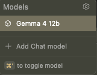

# AI on the edge

## Why not just use the app?

Everyone, their grandmother and their friend's dogwalker's web designer is using an LLM every day in one form or another. Sometimes it's intentional, but quite often it's not. It's the AI summary in a web page, it's a chatbot on a website to help you return some goods, or set up a new account. 

But all these LLMs need to run somewhere. Most of them live in great big data centres in on rack upon rack of machines who have made upgrading a simple gaming computer nigh on impossible for anyone of normal means in 2026. That means nearly every time you interact with them, your information, your data is leaving your machine and heading into the cloud. 

Normally we'd think this is fine, we do it every time we make a search, but then things like [this](https://www.bbc.co.uk/news/articles/cly5qgjk5ywo) happen and suddenly we remember what data sovereignty is and why we need it. 

But wait, I hear you cry, how does this affect me? I'm still going to _have_ to use those chatbots, those search results and everything. Yep, but you don't have to use cloud models all the time for everything. 

Now, I've worked in software for well over a decade now, closing in on two, and I know first-hand what a gamechanger the LLMs have been in the last year. And let me tell you, the moment I got my grubby little mitts on a claude subscription, I immediately thought "Why can't I do this locally?"

For you see, I am an ancient beast, and I remember the days when everything was local. Like a captive elephant, I remember the wild freedom of my youth. Sure I enjoy not needing to host a server for everything, but there's just something satisfying about having something running completely locally. In fact I took this to an extreme and had my macbook running a local LLM hooked into claude code while I was on a flight this year. Completely offline, but still producing code. It made me feel smug. I'm here to let you know that you can feel smug too. I can teach you how.


## So, how can I feel smug then?

Let me preface this by saying, I've only really set all this up on a mac with Apple silicon. Technically it should all work on any OS/architecture, but I haven't tested it and Apple silicon brings unified memory, which is a massive boon for this. Instead of needing a 16GB graphics card, I can just use my 16GB M1 pro macbook pro. So while I'm anything but an Apple shill, they're materially better in this case.

Firstly you need to look at what you're working with, what you want to do, and how you want to do it. The market for local LLM solutions has exploded, because there's nothing quite like having a $20 subscription change to a $6000 bill (thanks, Github for subsidising me!) to really get the creative juices flowing. So for me, having access to agentic coding tooling and all that opens up to you, was a priority. I was very lucky to be in possession of an Apple silicon macbook pro, as opposed to a more traditional laptop with a CPU and GPU and separate RAM for each of them. I was excepetionally lucky to have a model with _just_ enough RAM to actually run something useful. My macbook is 5 years old, so anything newer will be better for this. I won't say this will just work on a new Dell, or any other computer without unified RAM unless it's in posession of a fairly hefty graphics card.

Secondly you need to know how you want to use an LLM, is it a writing companion, a chatbot or coding assistant? Are you insane like me and have decided that actually you need to have the full LLM based coding environment with claude code, opencode or the like running on your machine? If you have what my colleague does, an M5 Max with 128GB of RAM, then maybe you're not only looking at that but you're considering using one of the bigger models. 

Because make no mistake, model size is important here. If you don't want to know the ins and outs of a 4bit quantised GGUF vs a 1 bit quantised model, vs a mixture of experts model with a small core that pulls in extra models when it needs them, I'd suggest you look for something in the Gemma4 line, they're generalists, they come in a mix of sizes and you can get one to fit your RAM from 8GB up to 128GB (though the 8GB is going to be shut down everything else level of tight on anything less than 16GB of RAM). Personally I use a mix of models, from the hefty Gemma4:e4b (4 bit quantised model, 128k token window, great for getting a lot out of your system), to the slightly smaller gemma4:12B, which is honestly my favourite openweights model to run locally. It fits neatly in my 16GB RAM, with space for an IDE as well. I'm writing this using VScode with the continue plugin using gemma4 12b. To the smaller, less capable but still decent Gemma4:e2b, which is probably not worth it unless you absolutely must have a model under 8 GB. I also use the absolutely _tiny_ Qwen2.5-coder:1.5b-base, which is under 1GB and as its name suggests is optimised for coding. Let me tell you, if you want an autocomplete model to run locally for your IDE, you can do a _lot_ worse than Qwen2.5-coder:1.5b. It'll barely sip your RAM and C/G/TPU while delivering autocomplete for most coding workloads in Python, Javascript and Java that's easily on par with what we had in IDEs 12 months ago. Obviously the more obscure the language or domain, the worse it will perform.

Now that probably looked like a word soup up there, with `e4b` and `1.5b` and models and so on. If you're not used to it, it's just a constant stream of jargon which is nearly impossible to decipher. Don't worry about it for now, see the glossary at the end of this document if you're curious. I used Gemma4:12B to compile that glossary while I was writing this. That's the power LLMs today. 

Thirdly, you need to know how much effort you want to put in. Sure I have a working set up, but it's going to take a fair bit of gluing together various technologies in ways they didn't generally expect people to glue them together, to get it working. It's an almost certainty that in 6 months, your IDE of choice will already ship with a runner for local LLMs and you can just choose the model to download and run from there. Because it's a lot cheaper for them as well as you, to have a local LLM to hand things like Git conflicts, file operations, refactors, test running and a million other very small tasks along side autocompletion and agentic coding. It's very interesting, it'll teach you a fair bit about how LLMs can be used, it'll definitely give you something you can put on the old CV. But is it necessary? Probably not, but the best projects I've done have been completely unncessary and at the same time, completely irreplaceable. 

So, with that in mind, let's get started.


## Getting Started

What machine do you have? I'm going to say this is only a guide for _Apple Silicon Macs with at least 16GB of RAM_ because that's what I've tested on. 

What runner do you want to use? This is nuanced, generally for beginners I'd say go Ollama and use an IDE like VScode with the [Continue](https://marketplace.visualstudio.com/items?itemName=Continue.continue) plug in, That'll give you access to a chatbot interface, an LLM server, a code assitant, agentic tooling and you can even plug MCP servers into it. Honeslty for just getting started, this is the quick and easy choice. I also use llama.cpp for when I want to have programatic access to LLMs with MCP servers for some of my [projects](https://github.com/Dominic-Kua/zuojia)

So now you probably know how you want to run this, and how you want to use it. But looking back up there, what do you want to run?
To keep things simple, we'll be using continue with Ollama backing it and we'll use 3 models. This sounds like a llot, but one is a simple embedding model, that is a model for converting text into vectors for the LLM to consume, this is nomic-embed and it's included in Ollama. Don't worry about it overly, just know nomic-embed is a top tier, very small and light model that is needed. We'll want a coding model to handle light and fast autocomplete, Qwen2.5-coder:1.5b-base is my choice here, less than a gig in size, blazing fast, competent enough to make you annoyed when it gets it wrong, because you've gotten so used to it getting it right. And my favourite model of the moment, Gemma4:12b. 

I've harped on about it enough in this post, but I'll leave a link to its [release announcement](https://blog.google/innovation-and-ai/technology/developers-tools/introducing-gemma-4-12b/), which lists the many ways in which it is awesome. I'll say that for me it's the perfect blend of size, competency and capability. It can integrate with tooling, it can parse images, it can even transcribe your voice notes if you want it to. It's shockingly powerful and it's got what we need to run a full featured coding agent. 

### Step One: Download the tooling
You're going to need
[VS Code](https://code.visualstudio.com/)
[Continue](https://marketplace.visualstudio.com/items?itemName=Continue.continue)
[Ollama](https://ollama.com/)

You know, I went through so many variations, I tried to get an LLM assistant working in neovim in January, that looking at the list now, well it seems too easy. 

Install those and we'll head to the next section:

### Installing the models. 
Once you have ollama installed, you'll want to open a terminal and input
```
ollama pull gemma4:e4b
ollama pull qwen2.5-coder:1.5b-base
```
Then just to check you should 
```
ollama list
```

which should get you something like: 

```
% ollama list
NAME                                      ID              SIZE      MODIFIED
gemma4:12b                                4eb23ef187e2    7.6 GB    7 days ago
tinyllama:latest                          2644915ede35    637 MB    7 days ago
gemma4:e4b                                c6eb396dbd59    9.6 GB    6 weeks ago
gemma4:e2b                                7fbdbf8f5e45    7.2 GB    7 weeks ago
qwen2.5-coder:1.5b-base                   02e0f2817a89    986 MB    6 months ago
llama3.1:8b                               46e0c10c039e    4.9 GB    6 months ago    
```

Now you should have VS code installed and the continue plug in installed. We're going to do some configuration now. 

### Configuring 
Continue is very configurable, and it will pull the config from `~/.continue/config.yaml` To complete the config I'm laying out here, you need to paste the following into that file if it exists, or create it with this in if it doesn't: 
```
name: Local Config
version: 1.0.0
schema: v1
models:
  - name: Gemma 4 12b
    provider: ollama
    model: gemma4:12b
    roles:
      - chat
      - edit
      - apply
    requestOptions:
      # Prevents the model from running out of memory on a 16GB Intel Mac
      contextLength: 8192 
    extraBodyProperties:
      # Suppresses internal reasoning streaming if token-per-second speeds lag on Intel CPU
      enable_thinking: false 

  - name: Qwen2.5-Coder 1.5B
    provider: ollama
    model: qwen2.5-coder:1.5b-base
    roles:
      - autocomplete

  - name: Nomic Embed
    provider: ollama
    model: nomic-embed-text:latest
    roles:
      - embed
```

Now if you have 24GB or more of RAM, you're laughing at 8k context, with 16GB, you might want to drop to 4k instead.

Now, open VS code and click the speech bubble in the centre top of the screen.


Then, you should see two options at the top right of the screen: 


Now, when you open the model picker in Continue, you should see the following:



If you do, congratualtions, you now have a local LLM in your VS code. You can set it loose on a project, add a feature or just play around with it. 

Bonus:
You can always open ollama and get access to a chat bot, if you sign up for a free ollama account, it can have websearch too, making it a powerful tool for, for example, debugging a local LLM setup! You would not believe the amount of time I've spent using LLMs to fix themselves. 


### Conclusion: 

Honestly, it's a lot simpler than I remember. I went through so many different set ups in the first months of this year that looking back at it, it feels like this should be more complicated than it is. I use this set up daily, so I can honestly say it works. I will say that the apple silicon _sips_ power, in the milliwatt range for the CPU, but a good agentic session can push that up to 30+ watts. That's not a huge amount, but it is noticable. Have fun and LLM responsibly. 


# Glossary of Terms: Local Large Language Models (LLMs)

### **Model Architecture & Optimization**

**Quantized Models (Quantization)**
Quantization is the process of reducing the precision of the numbers (weights) used in a neural network to make the model smaller and faster while maintaining as much "intelligence" as possible. In LLMs, this typically involves converting weights from 16-bit floats (FP16) to lower bit-widths like 8-bit (INT8) or 4-bit (INT4). This is essential for running large models on consumer-grade hardware (like a home PC), as it drastically reduces the amount of Video RAM (VRAM) required.
*   *Key formats:* GGUF (common for llama.cpp), EXL2, AWQ.
*   **Source:** [Hugging Face - Quantization Overview](https://huggingface.co/docs/optimum/concepts/quantization) | [LLM.tools - What is Quantization?](https://llm.tools/quantization/)

**Parameter Size (e.g., 7B, 70B)**
A "parameter" is a variable within the neural network that the model "learned" during its training phase. The size of a model (expressed as $B$ for billions) refers to the total count of these parameters. Generally, more parameters allow a model to handle more complex nuances and have a broader knowledge base, but they require significantly more memory and computing power to run.
*   **Examples:** 7B (Small/Fast), 13B (Medium), 70B+ (Large/Complex).
*   **Source:** [Meta AI - Llama Documentation](https://ai.meta.com/resources/publications/) | [NVIDIA - What are LLM Parameters?](https://blogs.nvidia.com/)

---

### **Common LLM Families (Open Weights)**
These are the foundational "base" models that developers and enthusiasts typically download to run locally:

*   **Llama (Meta):** The industry standard for open-weights models. Meta's Llama 3 series is currently one of the most widely supported architectures. ([Meta AI](https://llama.meta.com/))
*   **Mistral / Mixtral (Mistral AI):** Highly efficient models from a French company; Mistral "MoE" (Mixture of Experts) models are famous for high performance at lower compute costs. ([Mistral AI](https://mistral.ai/))
*   **Gemma (Google):** A family of lightweight, open-model variants built from the same technology used to create Google’s Gemini. ([Google DeepMind](https://deepmind.google/technologies/gemma/))
*   **Phi (Microsoft):** A series of "Small Language Models" (SLMs) designed to provide high intelligence with very few parameters, ideal for mobile or edge devices. ([Microsoft Research](https://microsoft.github.io/phi/))
*   **Qwen (Alibaba Cloud):** A powerful series of models that perform exceptionally well in coding and mathematics. ([Alibaba Qwen](https://github.com/QwenLM/Qwen))

---

### **Local Inference Mechanisms**
These are the software "engines" or wrappers used to load a model and interact with it on your local hardware:

*   **llama.cpp:** A high-performance C++ implementation designed for running LLMs on standard CPU and GPU hardware. It is the foundational technology for many other tools; it allows models to run in a "quantized" state very efficiently.
    *   **Source:** [GitHub - llama.cpp](https://github.com/ggerganov/llama.cpp)
*   **Ollama:** A user-friendly tool that simplifies the process of running LLMs locally. It acts as a wrapper around `llama.cpp`, providing a simple command-line interface and an API, making it easy to "install" and run models like Llama 3 or Mistral with one command.
    *   **Source:** [Ollama.com](https://Ollama.com/)
*   **LM Studio:** A GUI-based application that allows users to discover, download, and run local LLMs with a "chat" interface, providing an easy entry point for non-technical users. 
    *   **Source:** [LMStudio.ai](https://lmstudio.ai/)
*   **LocalAI](http://localai.io):** An open-source, self-hosted API that follows the OpenAI standard, allowing users to swap out OpenAI's servers for local hardware while keeping the same code structure.
    *   **Source:** [LocalAI GitHub](https://github.com/mudler/LocalAI)